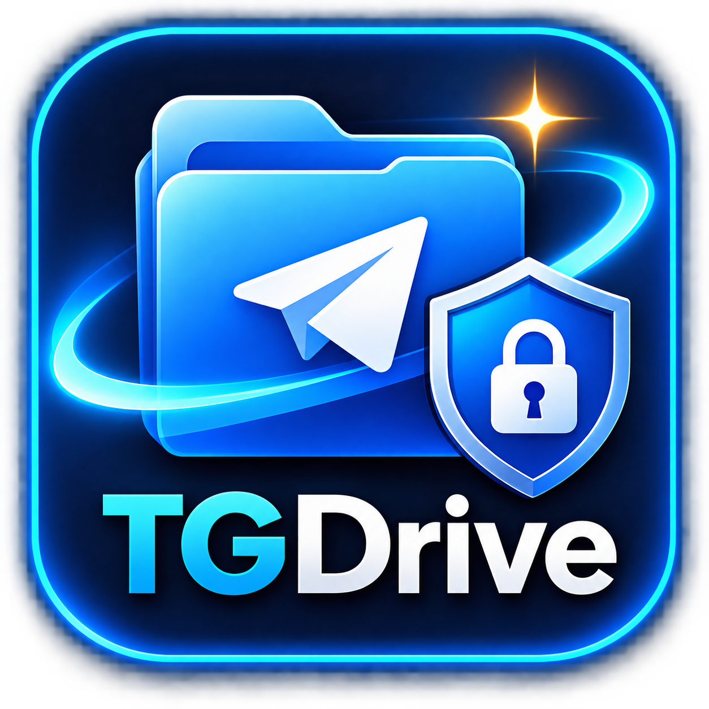

<p align="center">
  
</p>

<h1 align="center">TGDrive</h1>

<p align="center">
  An encrypted, serverless cloud drive powered by your private Telegram forum.
  <br />
  Your files. Your Telegram. Your control.
</p>

<p align="center">
  <strong>Client-side encryption · No backend · No database · Access from any device</strong>
</p>

---

## Overview

TGDrive turns your private Telegram forum supergroup into a personal encrypted cloud drive.

Files are encrypted directly in your browser and stored as opaque document chunks inside Telegram forum topics. Folders map to topics, while an encrypted index keeps track of files and metadata.

There is no separate backend, database, or account registration. Your browser communicates directly with Telegram using MTProto.

> **Development build:** TGDrive is a work in progress and is not intended to replace a dedicated backup solution.

## Features

- **Private Telegram storage** — One private forum supergroup acts as your drive.
- **Encrypted uploads** — Files are chunked and encrypted locally using AES-256-GCM.
- **Password-protected vault** — Recover your encryption keys across devices using a passphrase.
- **Folder management** — Telegram forum topics map to drive folders.
- **Encrypted file index** — Faster loading using an encrypted index snapshot.
- **Search** — Global and folder-level search powered by MiniSearch.
- **Category filters** — Filter images, videos, audio and documents.
- **File previews** — Preview supported media and documents.
- **File management** — Multi-select, copy, cut, paste and delete.
- **Upload queue** — Sequential uploads with retry and resumable sessions.
- **Trash** — Soft deletion, restoration and automatic 30-day retention.
- **Local caching** — IndexedDB caches encrypted index data and decrypted media.
- **Event history** — Encrypted activity events stored in Telegram.
- **Resilient operations** — Flood-wait handling and per-chunk retry/backoff.

## How It Works

```text
                 TGDrive
                    |
              Browser App
              Vue 3 + GramJS
                    |
              Telegram MTProto
                    |
          +---------+----------+
          |                    |
        Files                Folders
          |                    |
       Chunking              Topics
          |
     AES-256-GCM
          |
    Encrypted Chunks
          |
     Telegram Forum
          |
       Encrypted
       Manifests
       + Index
       + Vault
```

### Storage model

| Component      | Purpose                                      |
| -------------- | -------------------------------------------- |
| Telegram forum | Main storage container                       |
| Forum topics   | Drive folders                                |
| File chunks    | Encrypted file content                       |
| Manifests      | Encrypted file metadata and chunk references |
| `#index`       | Vault, encrypted index and event history     |
| `#trash`       | Reserved trash topic                         |
| IndexedDB      | Local index and media cache                  |

### File upload flow

1. Select a file in TGDrive.
2. The browser divides it into smaller chunks.
3. Each chunk is encrypted locally.
4. Encrypted chunks are uploaded as Telegram documents.
5. An encrypted manifest records file metadata and chunk references.
6. The encrypted index snapshot is updated.

Files are limited to 200 MB, with a default chunk size of 20 MB and a hard chunk-size ceiling of 45 MB.

## Security & Encryption

TGDrive is designed around client-side encryption. File contents and sensitive metadata are encrypted before being uploaded to Telegram.

### Cryptographic design

| Component            | Implementation            |
| -------------------- | ------------------------- |
| Master key           | Random 256-bit key        |
| File keys            | HKDF-SHA-256              |
| File encryption      | AES-256-GCM               |
| Chunk nonce          | 12 random bytes           |
| Chunk authentication | AAD: `fileId:index:count` |
| Vault key derivation | Argon2id                  |
| Vault encryption     | AES-256-GCM               |
| Local cryptography   | WebCrypto worker          |

### Key hierarchy

```text
                 Master Key
                     |
              HKDF-SHA-256
                     |
               Per-file Key
                     |
               AES-256-GCM
                     |
              Encrypted Chunks
```

Every file gets a unique encryption key derived from the master key.

### Vault protection

The master key is never stored unwrapped.

- A passphrase is used to derive a key-encryption key using Argon2id.
- The master key is wrapped using AES-256-GCM.
- The encrypted vault envelope is stored in the reserved `#index` topic.
- Unlocking requires the correct passphrase.
- Locking removes the master key from memory.

**Default Argon2id parameters:**

- Memory: 64 MiB
- Iterations: 3
- Salt: 16 random bytes

### Important security considerations

1. **API credentials:** `api_id` and `api_hash` are included in the browser bundle. Create a dedicated Telegram application for TGDrive.
2. **Session security:** MTProto session strings are stored in browser `localStorage`. Anyone obtaining the session string may access your Telegram account until it is revoked.
3. **Metadata visibility:** Telegram can see encrypted blob sizes, upload timing and the forum topics receiving the data.
4. **Unofficial client:** Automated Telegram account usage may trigger rate limits or account restrictions.
5. **Passphrase loss:** There is no password recovery. Losing the vault passphrase makes encrypted files unrecoverable.
6. **Backup warning:** Telegram storage is not a guaranteed backup. Maintain another copy of important files.

## Tech Stack

| Technology       | Purpose                       |
| ---------------- | ----------------------------- |
| Vue 3            | Frontend framework            |
| JavaScript       | Application logic             |
| GramJS           | Telegram MTProto client       |
| Vite             | Build tooling                 |
| Pinia            | State management              |
| Tailwind CSS     | UI styling                    |
| WebCrypto        | Encryption and hashing        |
| Argon2id         | Password-based key derivation |
| HKDF-SHA-256     | Per-file key derivation       |
| IndexedDB        | Browser-side caching          |
| MiniSearch       | File search                   |
| Cloudflare Pages | Static deployment             |

## Getting Started

### Requirements

- Node.js 22+
- npm 10+
- Chromium-based browser

### 1. Clone the repository

```bash
git clone https://github.com/praveen-pravi6B/tg-drive.git tg-drive
cd tg-drive
```

### 2. Install dependencies

```bash
npm install
```

### 3. Configure Telegram credentials

Create a Telegram application at [my.telegram.org](https://my.telegram.org).

Navigate to **API development tools → App configuration**.

Create `.env.local` from the example:

```bash
cp .env.example .env.local
```

Add your credentials:

```dotenv
VITE_TG_API_ID=12345678
VITE_TG_API_HASH=0123456789abcdef0123456789abcdef

# Optional
VITE_TG_CHUNK_SIZE=20971520
```

### 4. Start the development server

```bash
npm run dev
```

Open the URL printed by Vite.

### 5. Connect Telegram

Scan the QR code using:

**Telegram → Settings → Devices → Link Desktop Device**

Alternatively, use phone authentication and the 2FA fallback.

If environment credentials are not configured, TGDrive provides a one-time credential form.

## Available Scripts

| Command           | Description                               |
| ----------------- | ----------------------------------------- |
| `npm run dev`     | Start the development server              |
| `npm run build`   | Build the production application          |
| `npm run preview` | Preview the production build              |
| `npm run lint`    | Run ESLint                                |
| `npm run format`  | Format source files                       |
| `npm run smoke`   | Build and run headless Chrome smoke tests |

The smoke test is hermetic and maps `*.telegram.org` to localhost, so it does not communicate with Telegram's real servers.

## Project Structure

```text
src/
├── main.js
├── polyfills.js
│
├── lib/
│   ├── config.js
│   ├── logger.js
│   ├── utils.js
│   │
│   ├── crypto/
│   │   ├── bytes.js
│   │   ├── kdf.js
│   │   └── chunk.js
│   │
│   ├── vault/
│   │   ├── format.js
│   │   └── vault.js
│   │
│   ├── drive/
│   │   ├── manifest.js
│   │   ├── files.js
│   │   ├── index.js
│   │   ├── indexCache.js
│   │   ├── mediaCache.js
│   │   ├── eventLog.js
│   │   └── uploadSessions.js
│   │
│   └── telegram/
│       ├── session.js
│       ├── topics.js
│       ├── drive.js
│       └── retry.js
│
├── stores/
│   ├── auth.js
│   ├── vault.js
│   └── drive.js
│
├── views/
│   ├── LoginView.vue
│   ├── DriveView.vue
│   ├── VaultView.vue
│   └── NotFoundView.vue
├── components/
│   └── ui/
│
└── workers/
    └── crypto.worker.js
```

### Browser MTProto compatibility

GramJS is primarily Node-oriented. TGDrive uses `vite-plugin-node-polyfills` to provide required Node-compatible modules, including:

- `crypto`
- `util`
- `stream`
- `events`
- `Buffer`
- `process`

This increases the production bundle size, which is an accepted trade-off for browser-based MTProto communication.

## Deployment

TGDrive can be deployed as a static application using Cloudflare Pages.

### Cloudflare Pages configuration

| Setting          | Value           |
| ---------------- | --------------- |
| Framework preset | None / Vite     |
| Build command    | `npm run build` |
| Output directory | `dist`          |
| Node.js version  | 22              |

### Environment variables

Configure the following under **Cloudflare Pages → Settings → Environment variables**:

```dotenv
VITE_TG_API_ID=your_api_id
VITE_TG_API_HASH=your_api_hash
```

Set them for both Production and Preview environments.

The project includes:

- `public/_redirects` — SPA fallback configuration.
- `public/_headers` — Security headers and Content Security Policy.
- `.github/workflows/build.yml` — GitHub Actions build workflow.

The Content Security Policy permits `wasm-unsafe-eval` for WebAssembly-based Argon2id through `hash-wasm`. General `eval` is not enabled.

## Known Limitations

- Maximum file size is 200 MB.
- Uploads are processed sequentially.
- Telegram rate limits still apply.
- First-time folder scans or migrations may require reading existing manifests.
- Clearing browser storage removes local sessions and caches.
- Signing in again allows the drive to be rediscovered through its Telegram marker.
- Telegram can restrict, delete or lose stored data.
- The application is a development build and should not be treated as a production backup solution.
- Low-severity npm advisories exist in the development-only `vite-plugin-node-polyfills` dependency tree.

## Contributing

Contributions are welcome. Please read [CONTRIBUTING.md](CONTRIBUTING.md) for guidelines.

## Security

For reporting vulnerabilities, please see [SECURITY.md](SECURITY.md).

## License

This project is licensed under the [MIT License](LICENSE).
